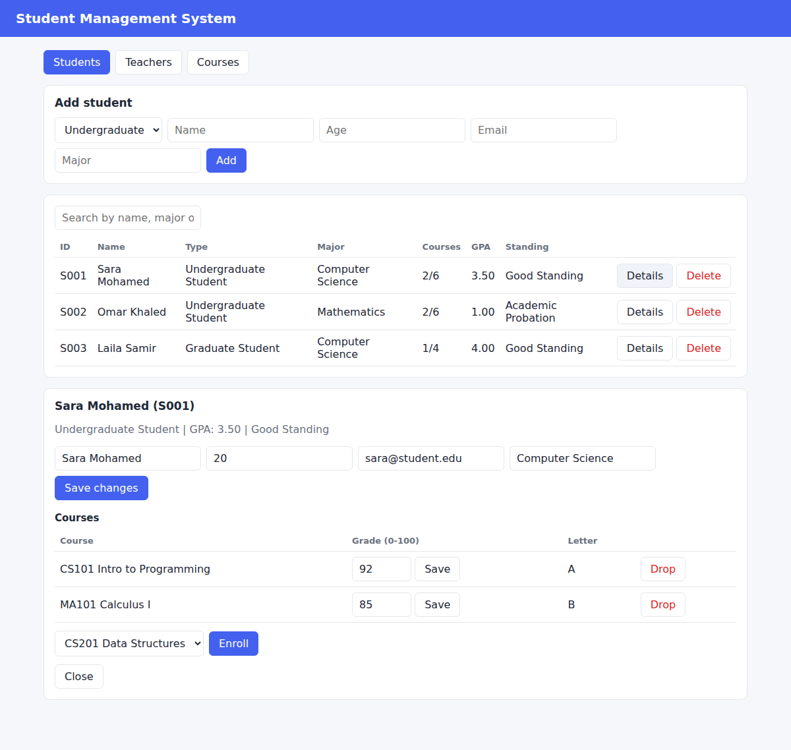
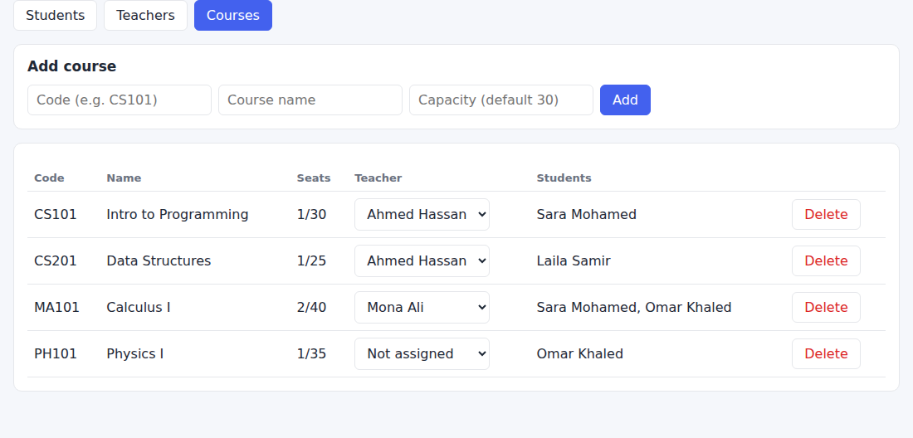

<div align="center">

# 🎓 Student Management System


**A Python project for managing students, teachers, courses, enrollments and grades, built to apply the core concepts of Object-Oriented Programming.**

[Description](#-project-description) · [OOP Concepts](#-oop-concepts-used) · [Features](#-features) · [Structure](#-project-structure) · [How to Run](#-how-to-run) · [Implementation](#-implementation) · [Author](#-author)

</div>

---

## 📌 At a Glance

| 6 | 2 | 10 | 0 |
|:---:|:---:|:---:|:---:|
| Model classes | Interfaces (web and console) | Unit tests | Packages to install |

---

## 📖 Project Description

The system helps a school administrator keep track of its people and courses. You can register **undergraduate and graduate students**, add **teachers** and **courses**, assign teachers to courses, **enroll** students, **record grades**, and see each student's **GPA** and **academic standing**.

The project is split into small modules so every part has one job:

- **`models/`** holds the data and the rules of each object (a student validates its own age, a course knows its capacity).
- **`school.py`** holds the logic that connects the objects (enrolling, searching, saving to disk).
- **`main.py`** and **`web_app.py`** are two interfaces that only call `School`. They contain no business rules, so the same logic works in the console and in the browser.

Data is saved automatically to `data/school.json` after every change.

<div align="center">

<br/><br/>

</div>

---

## 🧩 OOP Concepts Used

| Concept | Where it is used |
|---|---|
| **Classes and Objects** | `Student`, `Teacher`, `Course` and `School`. Every record in the system is an object. |
| **Constructors** | Every class has an `__init__`. Subclasses call `super().__init__()`, and `GraduateStudent` adds its own `thesis` parameter. |
| **Encapsulation** | Data is stored in private attributes (`_name`, `_age`, `_grades`) and accessed through `@property` getters and setters that validate the value. `person_id` has no setter, so it is read-only. |
| **Abstraction** | `Person` and `Student` are abstract classes (`ABC`). They declare `get_role()`, `get_details()`, `max_courses()` and `standing()` without implementing them, so they cannot be instantiated directly. |
| **Inheritance** | `Student` and `Teacher` inherit name, age and email handling from `Person`. `UndergraduateStudent` and `GraduateStudent` inherit from `Student` (multilevel inheritance). |
| **Polymorphism** | Each student type overrides `get_role()`, `max_courses()` and `standing()`. The code calls the same method on any student and gets the behavior of its own type. |
| **Exception Handling** | Custom exceptions in `exceptions.py` are raised by the models and by `School`, and both interfaces catch them and show a clear message instead of crashing. |

```
Person (abstract)
├── Student (abstract)
│   ├── UndergraduateStudent
│   └── GraduateStudent
└── Teacher
```

### Polymorphism in action

| | Undergraduate | Graduate |
|---|:---:|:---:|
| Maximum courses | 6 | 4 |
| Good standing needs GPA of | 2.0 or more | 3.0 or more |
| Extra data | none | thesis topic |

### Custom exceptions

| Exception | Raised when |
|---|---|
| `ValidationError` | A name, age, email, grade, course code or capacity is invalid |
| `NotFoundError` | A student, teacher or course ID does not exist |
| `DuplicateError` | An email or course code is already used |
| `EnrollmentError` | Already enrolled, course is full, course limit reached, or deleting a course that still has students |

All of them inherit from `SchoolError`, so one `except SchoolError` catches any of them.

---

## ✨ Features

**Students**
- Add, list, search (by name, major or ID), update and delete students
- Two student types with different rules (undergraduate and graduate)
- Per-student profile with courses, grades, GPA and academic standing

**Teachers and courses**
- Add and delete teachers, add and delete courses
- Assign a teacher to a course and see who is enrolled in each course

**Enrollment and grades**
- Enroll and drop students with checks for duplicates, full courses and the course limit
- Record grades from 0 to 100, with a letter grade and GPA calculated automatically

**General**
- Input validation on every field, with clear error messages
- Automatic saving and loading from a JSON file
- Browser interface and console interface
- Sample data (`--demo`) and unit tests

### Business rules

| Rule | Value |
|---|---|
| Student age | 15 to 70 |
| Teacher age | 21 to 75 |
| Course capacity | 1 to 200 (default 30) |
| Grade scale | A 90+, B 80+, C 70+, D 60+, F below 60 |
| Grade points | A = 4, B = 3, C = 2, D = 1, F = 0 |
| GPA | Average grade points of the graded courses |
| Emails | Must be unique among students and among teachers |
| Deleting a course | Not allowed while students are enrolled in it |
| Deleting a teacher | Allowed, and their courses become unassigned |

---

## 📁 Project Structure

```
student-management-system/
├── main.py                 # console interface
├── web_app.py              # browser interface (small web server)
├── school.py               # School class: logic, searching, saving and loading
├── exceptions.py           # custom exceptions
├── models/
│   ├── person.py           # Person (abstract)
│   ├── student.py          # Student (abstract), UndergraduateStudent, GraduateStudent
│   ├── teacher.py          # Teacher
│   └── course.py           # Course
├── static/
│   └── index.html          # the web page (HTML, CSS and JavaScript)
├── tests/
│   └── test_school.py      # unit tests
├── assets/                 # screenshots used in this README
├── data/                   # school.json is created here when you run the project
├── .gitignore
└── README.md
```

---

## 🚀 How to Run

**Requirements:** Python 3.8 or newer. There is nothing to install.

### 1. Get the project
```bash
git clone https://github.com/<Mina-Magdy-22>/<AITRONIX-Student-Management-System>.git
cd <AITRONIX-Student-Management-System>
```

### 2. Choose an interface

**Browser interface** (opens at `http://127.0.0.1:8000`)
```bash
python web_app.py
```
Press `Ctrl+C` in the terminal to stop it. The server only listens on your own computer.

**Console interface**
```bash
python main.py
```

### 3. Try it with sample data
```bash
python web_app.py --demo
python main.py --demo
```
Sample data is only loaded when the data is empty, so it never overwrites your records.

### 4. Run the tests
```bash
python -m unittest discover -v
```
The tests cover validation, abstract classes, polymorphism, enrollment rules, GPA, searching, deleting and saving/loading data.

---

## 🛠 Implementation

This project is implemented as a **multi-file Python project** (the bonus option), divided into logical modules: models, business logic, two interfaces and tests.

---

## ⚠️ Notes

- Data is stored in a single JSON file, which is enough for one user on one computer.
- The web server is meant for local use and has no login.
- GPA is a simple average of grade points, not weighted by credit hours.

---

## 👤 Author

**Mina Magdy**
